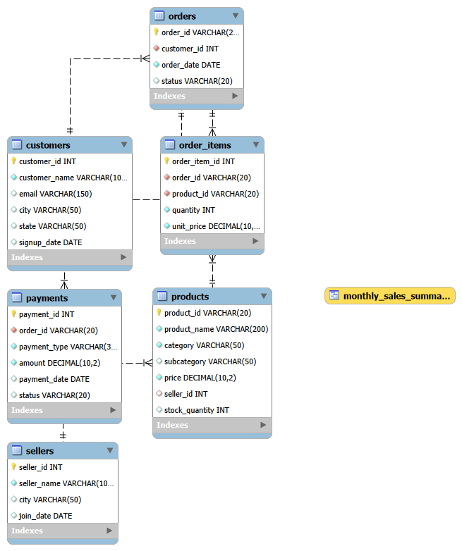
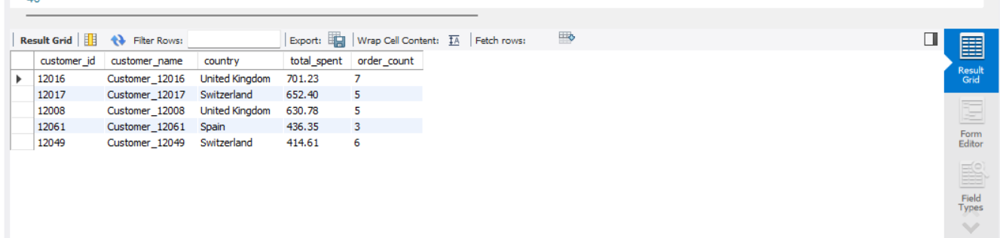
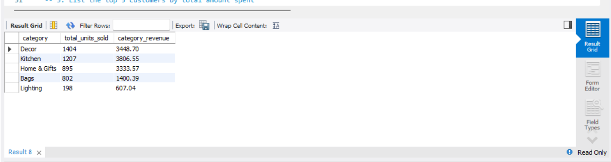
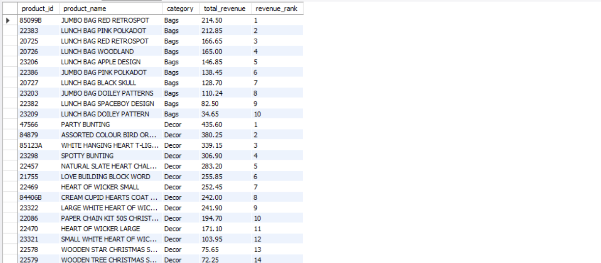
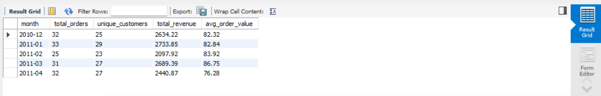
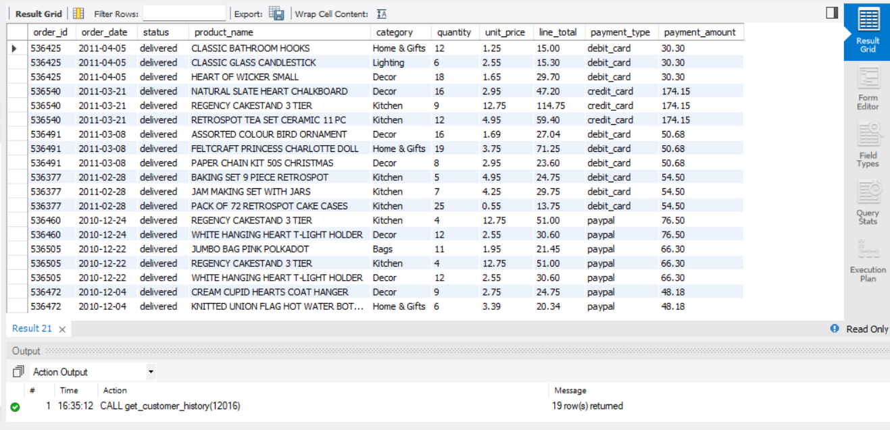

# E-Commerce Sales & Customer Analytics (MySQL)

SQL analysis of an online retail store's sales and customers using MySQL.

**Dataset**: Normalized sample inspired by the UCI Online Retail dataset  
(UK-based online gift retailer)

---

## 📌 Project Overview

This project simulates a real online store with customers, orders, products, sellers, and payments.  
It answers real business questions that data analysts face at work.

**What is included:**
- A working MySQL database with 6 tables
- 20+ solved business questions (Beginner → Intermediate → Advanced)
- Window functions, CTEs, Views, and a Stored Procedure
- Clean documentation ready for GitHub

---

## 🛠️ Tools Used

- MySQL Workbench
- SQL concepts: SELECT, JOINs, GROUP BY, HAVING, Window Functions, CTEs, Subqueries, Views, Stored Procedures

---

## 📊 Dataset

Custom sample data inspired by the UCI Online Retail dataset  
(UK gift store style transactions from 2010–2011)

| Table | Rows |
|---|---|
| sellers | 4 |
| customers | 80 |
| products | 60 |
| orders | 180 |
| order_items | 520 |
| payments | 180 |

Orders carry realistic status variation (delivered, shipped, pending, cancelled) with matching
payment statuses, so revenue queries filter to `status = 'delivered'` rather than assuming
every order completed.

---

## 🗂️ Project Structure

```
ecommerce-sql-analytics/
├── README.md
├── schema/
│   └── create_tables.sql
├── data/
│   └── sample_data.sql
├── queries/
│   ├── 01_beginner_questions.sql
│   ├── 02_intermediate_questions.sql
│   └── 03_advanced_questions.sql
└── screenshots/
    ├── er_diagram.png
    └── (query result screenshots)
```

---

## ▶️ How to Run

1. Open `schema/create_tables.sql` in MySQL Workbench and execute it — creates the
   `ecommerce_analytics` database and all 6 tables.
2. Open `data/sample_data.sql` and execute it — loads the sample dataset.
3. Open any file in `queries/` and run statements one at a time (`Ctrl+Enter` on each)
   to see individual result grids.

---

## 🧩 Entity-Relationship Diagram



Generated in MySQL Workbench via **Database → Reverse Engineer**. Six tables:
`customers` place `orders`, each `order` contains multiple `order_items`, each
`order_item` references a `product`, each `product` belongs to a `seller`, and each
`order` has one `payment` record.

---

## 🔑 Key Business Questions Answered

Below are a few highlights — the full set of 20+ queries is in `queries/`.

**Top 5 customers by total spend**
```sql
SELECT c.customer_id, c.customer_name, c.state AS country,
       ROUND(SUM(oi.quantity * oi.unit_price), 2) AS total_spent,
       COUNT(DISTINCT o.order_id) AS order_count
FROM customers c
JOIN orders o ON c.customer_id = o.customer_id
JOIN order_items oi ON o.order_id = oi.order_id
WHERE o.status = 'delivered'
GROUP BY c.customer_id, c.customer_name, c.state
ORDER BY total_spent DESC
LIMIT 5;
```


**Best-selling product category**
```sql
SELECT p.category, SUM(oi.quantity) AS total_units_sold,
       ROUND(SUM(oi.quantity * oi.unit_price), 2) AS category_revenue
FROM order_items oi
JOIN products p ON oi.product_id = p.product_id
JOIN orders o ON oi.order_id = o.order_id
WHERE o.status = 'delivered'
GROUP BY p.category
ORDER BY total_units_sold DESC;
```


**Rank products by revenue within each category (window function)**
```sql
WITH product_revenue AS (
    SELECT p.product_id, p.product_name, p.category,
           ROUND(SUM(oi.quantity * oi.unit_price), 2) AS total_revenue
    FROM products p
    JOIN order_items oi ON p.product_id = oi.product_id
    JOIN orders o ON oi.order_id = o.order_id
    WHERE o.status = 'delivered'
    GROUP BY p.product_id, p.product_name, p.category
)
SELECT product_id, product_name, category, total_revenue,
       RANK() OVER (PARTITION BY category ORDER BY total_revenue DESC) AS revenue_rank
FROM product_revenue
ORDER BY category, revenue_rank;
```


**Monthly sales summary (view)**
```sql
SELECT * FROM monthly_sales_summary;
```


**A customer's full order history (stored procedure)**
```sql
CALL get_customer_history(12016);
```


---

## 💡 What I Learned

Practiced window functions (`RANK`, `LAG`) for ranking and month-over-month growth analysis,
CTEs for breaking multi-step aggregations into readable pieces, and views/stored procedures
for packaging logic a BI tool or application could call directly. Also learned to sanity-check
a synthetic dataset before writing queries against it — filtering to `status = 'delivered'`
only mattered once the data had more than one status value to filter on.
